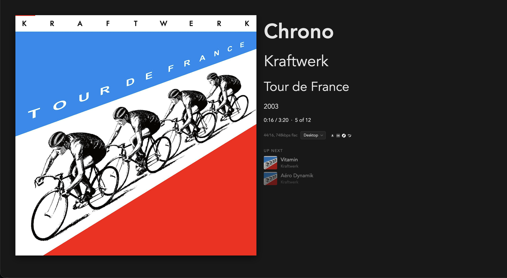

# Plex Now Playing Viewer

This provides a simple client-side application to display "Now Playing" information from your Plex Media Server. It uses the Plex API to fetch the current playing track details and updates the UI dynamically.

## Features

- Fetches and displays the currently playing track information.
- Shows track metadata such as artist, album, title, and duration.
- Displays album art with a dominant color-based progress bar.
- Provides external links to artist information on Album of the Year, Last.fm, and Discogs.
- Real-time progress tracking for the currently playing track.
- Synced lyrics that scroll along with the track (needs Plex Pass). Plain, untimed lyrics scroll through at the pace of the track. The lyrics stay folded away as a small "Lyrics" button, which only appears when the track has lyrics. Click it to open them over the album details; click again or press Esc to close.
- An "Up next" list with the next two tracks in the play queue.
- Instant updates when you pause, resume or skip, through Plex's live notifications.
- An idle screen when nothing is playing, with your recently played tracks and recently added albums. In the main and phone layouts, the album square shows your listening in the last 7 days: plays, artists and albums, plays per day, and your top artists.
- The browser tab icon shows the cover of the current album (and an equaliser icon when nothing plays).


## Prerequisites

- A Plex Media Server.
- An API key for your Plex server.
- Basic knowledge of setting up a local development environment.

## Setup
1. **Clone the repository**:
   To clone this repository to your local machine, run the following command:

   ```bash
   git clone https://github.com/peterdconradie/plexdash.git
   ```

2. **Copy the files**:
   Copy the entire `plexdash` folder to wherever you prefer to run it from. Make sure you retain the folder structure.

3. **Add your Plex API key and server URL**:
   Rename the file `apikey_CHANGE_THIS.js` to `apikey.js` in the project directory. Then, update the file with your Plex API key and server URL by replacing the placeholder values:

   ```javascript
   const plexApiKey = "YOUR_PLEX_API_KEY"; // Find it here: https://support.plex.tv/articles/204059436-finding-an-authentication-token-x-plex-token/
   const plexServerUrl = "http://192.168.1.1:32400"; // Your Plex server URL
   export {
       plexApiKey, plexServerUrl
   };
   ```

4. **Open the project in a browser**:
   To view the project, you'll need to run it on a local web server. If you're on a Mac, navigate to the project directory in the terminal and run:

   ```bash
   python3 -m http.server
   ```

   This will start a local web server on port `8000`. Open your browser and go to `http://localhost:8000` to view the project.

## Layouts
- `index.html`: the standard landscape layout.
- `v.html`: a vertical layout, made for Vivaldi's sidebar.
- `m.html`: a layout for phone screens.

If more than one Plex player is active, `index.html` and `m.html` show a dropdown to choose which one to display. The choice is remembered in the browser.

## Settings
At the top of `get_info.js` you can change:
- `POLL_INTERVAL_MS`: how often Plex is polled (default 2 seconds).
- `SHOW_LYRICS`, `SHOW_UP_NEXT`, `SHOW_IDLE_SCREEN`: turn lyrics, the up next list or the idle screen off.
- `LIVE_UPDATES`: turn Plex's live notifications off (this also turns off up next, which depends on them).
- `DEBUG`: log poll results and notifications to the console.

The number of upcoming tracks is set by `UP_NEXT_COUNT` in `upnext.js`, and the number of recently played tracks and recently added albums by `RECENT_TRACKS` and `RECENT_ALBUMS` in `idle.js`.

### Notes on lyrics and up next
- Lyrics come from Plex itself: either `.lrc`/`.txt` files next to your music, or lyrics Plex downloads automatically (Plex Pass). If a track has no lyrics, the lyrics area stays hidden. While lyrics are scrolling you can scroll them yourself; auto-scroll resumes after 5 seconds.
- Plex doesn't include the play queue in the "now playing" data, so the app learns it from the live notifications Plex sends while a track plays. Up next can therefore take a few seconds to appear after you open the page.
- If another app on your account starts its own play queue, Plex may drop the old one; up next then stays hidden until the next track.

Note: the Plex token is sent to every browser that opens the page. Only run this on your own network, and don't expose it to the internet (for example via ngrok) unless you are fine with others seeing the token.

## What does it look like?



## Issues
- Plex only updates the playback position every few seconds, so after seeking the progress bar can take a moment to catch up.


## License

This project is open-source and licensed under the MIT License.

## Related
This project was inspired by [PlexampStatusPage](https://github.com/claesbert/PlexampStatusPage), check it out! 


